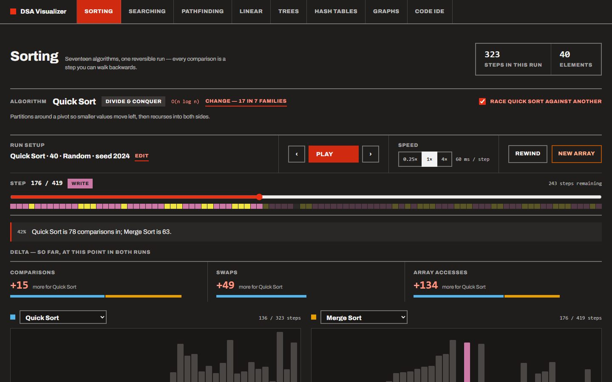
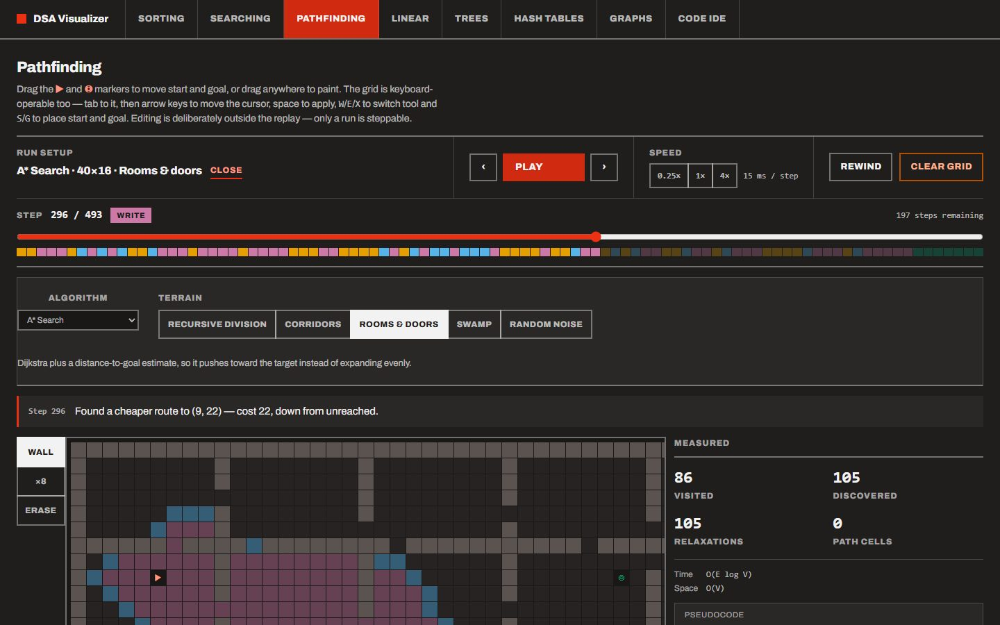
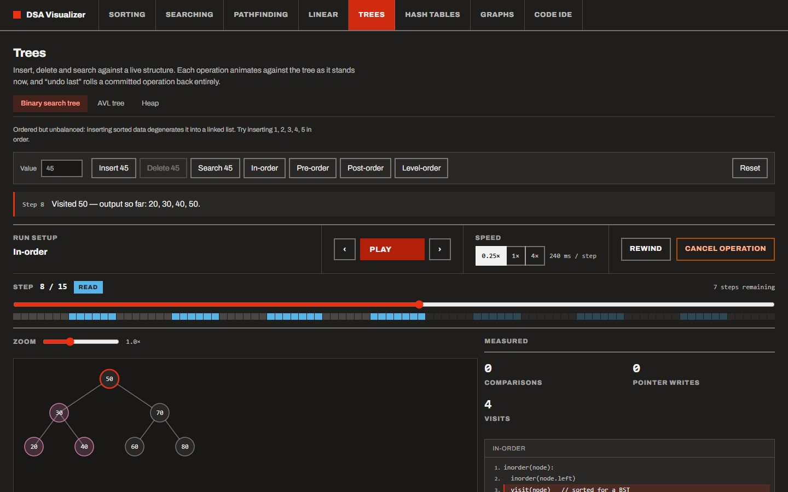

# DSA Visualizer

An interactive visualizer for data structures and algorithms, built with React, TypeScript and Vite.

**Live:** https://sorting-visualization-29fd0.web.app

[](https://github.com/imnishant2512/dsa-visualizer/actions/workflows/ci.yml)
[](https://github.com/imnishant2512/dsa-visualizer/actions/workflows/codeql.yml)
[](LICENSE)

Every visualization runs on the same replay engine: an algorithm emits discrete, **exactly reversible** steps, and a player walks a cursor through them. That single design decision is what makes it possible to pause anywhere, step _backwards_ through an individual comparison, scrub to any point in a run, or change speed mid-animation without restarting — none of which is possible when animation delays are baked into the algorithm itself.

**Race mode** — two algorithms, one array, one clock. Each run is 42% of the way through, and the strip shows how far apart they are:



**Pathfinding** — A\* working through a rooms-and-doors maze, each step narrated:



**Interactive structures** — operations run against a live tree and land in an undoable history:



## What's in it

| Domain                | Contents                                                                                                                           |
| --------------------- | ---------------------------------------------------------------------------------------------------------------------------------- |
| **Sorting**           | 17 algorithms, playback controls, live stats, pseudocode panel, side-by-side race mode                                             |
| **Searching**         | Linear, binary, jump, interpolation, exponential                                                                                   |
| **Pathfinding**       | BFS, DFS, Dijkstra, A*, greedy best-first, Bellman-Ford on a grid you draw walls and weights on                                    |
| **Linear structures** | Array, stack, queue, linked list                                                                                                   |
| **Trees**             | BST, AVL with step-through rotations, min/max heaps, four traversals                                                               |
| **Hash tables**       | Chaining vs linear probing, collisions, tombstones                                                                                 |
| **Graphs**            | Interactive graph building, BFS/DFS traversal, Dijkstra and A* shortest paths, topological sort, cycle detection, Prim and Kruskal |
| **Code IDE**          | Six languages in a Monaco editor — JavaScript in a sandboxed worker, the rest compiled on Wandbox                                  |

### Algorithms

**Sorting (17)** — grouped by the machinery they share:

- _Bubble family_: bubble, cocktail shaker, comb, gnome
- _Insertion family_: insertion, shell
- _Selection family_: selection, cycle
- _Divide & conquer_: merge, quick (Lomuto), heap
- _Hybrids_: Timsort and Introsort, composed from the generators above rather than reimplemented
- _Non-comparison_: counting, radix (LSD), bucket
- _For fun_: bogo (size-capped, for obvious reasons)

**Searching (5)**: linear, binary, jump, interpolation, exponential.

**Pathfinding (6)**: BFS, DFS, Dijkstra, A*, greedy best-first, Bellman-Ford.

**Graphs (8)**: BFS, DFS, Dijkstra, A*, topological sort, cycle detection, Prim and Kruskal — plus node/edge editing as first-class undoable operations.

## Features

- **Real playback** — play, pause, step forward, step back, scrub to any step, change speed live mid-run.
- **Live stats** — comparisons, swaps, accesses, probes, collisions and more, counted per step and unwound exactly when you step backwards. Non-comparison sorts visibly hold `comparisons` at zero.
- **Pseudocode panel** — highlights the line the current step is executing.
- **Race mode** — run two sorting algorithms against the identical starting array under one shared clock, each with its own stats.
- **Interactive structures** — trees, graphs, hash tables and linear structures accumulate operations against a persistent structure, with a history panel and undo.
- **Input shapes** — random, nearly sorted, reversed, or few-unique arrays, so you can watch insertion sort go near-linear or quicksort degrade.
- **Keyboard control** — Space to play or pause, ← and → to step. Shortcuts yield whichever key the focused control already owns, so arrows still adjust a focused slider.
- **Shareable links** — the sorting and searching pages keep their setup in the URL, so a link reproduces the exact run. Inputs travel as a seed rather than as an array.
- **Visualize your own sort** — write a sort in the IDE and it replays on the same engine as the built-in ones, step by step and backwards. It is checked for correctness, and its counts are compared with a built-in algorithm. It runs in a sandboxed worker with a timeout and a step cap.
- **Code IDE** — a scratchpad for your own code in six languages. JavaScript runs in a
  terminable Web Worker in the tab, so an infinite loop is stopped after five seconds
  instead of freezing the page; the compiled languages go to wandbox.org, which the
  toolbar says plainly. Compiler diagnostics are shown in full and marked in the gutter.
- **Colour-blind safe** — visualization states use the Okabe-Ito palette and are separated by lightness as well as hue, so they survive deuteranopia, protanopia and greyscale.

## Architecture

```
src/
  engine/                     Generic replay engine — knows nothing about any domain
    types.ts                    StepEngine<TState, TStep>, AlgorithmDefinition, Frame
    player.ts                   buildSteps, initFrame, stepForward, stepBack, seek
    useStepPlayer.ts            Batch mode: cursor + timer, externally controlled playback
    useInteractiveStructure.ts  Operation mode: persistent structure + operation history
  domains/
    sorting/ searching/ pathfinding/ linear/ trees/ hashtables/ graphs/
      types.ts        the domain's State and Step union
      engine.ts       its StepEngine (applyStep / invertStep / statsDelta)
      algorithms.ts   or operations.ts — pure generators
      components/     its renderer and page
    ide/            not a visualizer: Monaco + the two executors, code-split
  shared/components/  RunBar, Narration, BarChart, StatsPanel, PseudocodePanel,
                      OperationHistoryPanel
  app/                Router (one lazy chunk per domain), layout, landing,
                      404 and error pages
e2e/                  Playwright suite against the production build
scripts/              README screenshots, release notes
```

A domain supplies three things and gets the whole player for free:

1. a `State` type,
2. a `Step` discriminated union, and
3. a `StepEngine` — a pure `applyStep` / `invertStep` pair plus a stats-delta table.

**The load-bearing invariant** is that every step carries enough prior data (`prevValue`, `prevChildId`, `prevDist`, …) that `invertStep` never needs to recompute or search backwards. `invertStep(applyStep(s, step), step)` must deep-equal `s` — asserted for every step of every algorithm in the test suite, and it caught two real bugs during the build.

Two consequences of that invariant worth knowing, because they shaped the design:

- **Ordered lists must be append-only.** Graph traversal keeps visited and frontier as separate append-only lists rather than moving ids between them, because removing an id from the middle of a list can't be undone without recording its position.
- **Repeated work needs a cursor, not a set.** Bellman-Ford re-sweeps cells, so it emits a `scan` step that moves a single cursor instead of the cumulative `visit` step the other pathfinders use.

### Batch vs operation mode

Sorting, searching and pathfinding are **batch**: configure the input, hit play, and one full run's steps are generated up front and replayed.

Trees, graphs, hash tables and linear structures are **operation mode**: a persistent structure accumulates user-triggered operations. Three things that are easy to conflate stay distinct there — stepping back _inside_ the running operation, cancelling an uncommitted operation, and undoing a _committed_ one. Both modes drive the same cursor primitives, and `RunBar` takes identical props either way.

## Running it

Requires **Node.js 20.19 or higher** (`.nvmrc` pins the version CI uses).

```bash
npm install            # also installs the pre-commit hook
npm run dev            # dev server at localhost:5173
npm run build          # typecheck + production build
npm run preview        # serve the production build, with the production headers
npm test               # vitest — unit and component tests
npm run test:coverage  # the same, with coverage and its thresholds
npm run test:e2e       # build, then run the end-to-end suite in Chrome
npm run verify         # everything CI checks except end-to-end, in CI's order
npm run screenshots    # regenerate the README images from the build
```

The end-to-end suite drives the Google Chrome already installed on the
machine (Playwright's `chrome` channel), so it needs Chrome but no separate
browser download.

## Deploying

Hosted as a static build on Firebase Hosting. **CI deploys:** every push to
`main` that passes the checks goes live, and every pull request gets a
seven-day preview URL. Both ship the exact bundle CI verified. The one-time
credential setup is in [CONTRIBUTING.md](CONTRIBUTING.md#deployment).

Deploying by hand still works, and needs a Google account:

```bash
npx firebase-tools login          # interactive, opens a browser
npx firebase-tools use --add      # pick or create a project, alias it "default"
npm run deploy                    # builds, then deploys dist/
```

`npm run deploy:preview` publishes to a temporary preview channel instead, which
is useful for checking a change before it goes live.

**Why the rewrite rule matters.** The app uses client-side routing, so a shared
link such as `/sorting?algo=quick&seed=2024` is a request for a path that does
not exist on disk. The `"**" → /index.html` rewrite in `firebase.json` is what
makes those links resolve; without it every deep link 404s and the shareable-URL
feature is dead on arrival. Any other static host needs the same fallback —
Vercel and Netlify infer it, GitHub Pages needs a `404.html` copy of
`index.html`.

**Every page is code-split.** Each domain is its own chunk, fetched when its
route is first opened, so the entry bundle is about 357 kB (114 kB gzipped).
Monaco is several times the size of everything else and is only fetched on
`/ide`.

**Nothing loads from another origin.** Monaco and the Archivo font are both
bundled rather than pulled from a CDN, so the site works offline and runs
under a Content-Security-Policy of `'self'`, plus wandbox.org for the IDE's
compiled languages. `firebase.json` also sets `nosniff`, a referrer policy,
a permissions policy, COOP, and frame denial. `vite preview` serves the same
headers, so the end-to-end suite runs under the production policy.

Asset filenames are content-hashed by Vite, so they are served `immutable` for a
year while every route serving `index.html` is never cached — otherwise a returning visitor keeps
loading an old page that points at asset hashes the deploy no longer has.

## Tests

Two suites, which cover different things.

**End-to-end** (`e2e/`, 48 tests) runs real Chrome against the production
build. It is where the parts jsdom only simulates are exercised for real: the
Web Worker that sandboxes user code (on the minified bundle, since the IDE
stringifies functions into workers), layout and visibility, pointer and
keyboard input on the pathfinding grid, and the real playback clock. Every
test also fails if the page throws or logs an error. It found three defects
the unit suite could not: mistyped URLs silently showing the homepage, the
nav losing its highlight on three of the four linear-structure tabs, and a
missing favicon. It also checks that every page loads under the CSP with no
third-party request, and runs an axe scan of every route that fails on any
serious or critical WCAG 2.1 AA violation.

**Unit and component** (`src/`, 594 tests, with a coverage floor enforced in
CI) covering:

- the pages themselves — URL round-tripping, the bogo size cap, playback
  stopping on its own, race mode wiring, and the keyboard focus rules. Every
  bug that actually reached the browser during this build lived in this layer,
  not in the algorithms;
- the `useStepPlayer` hook itself — that mounting, StrictMode double-rendering
  and swapping algorithms mid-run do not trigger a render loop, since the reset
  is done by adjusting state during render rather than in an effect;
- every sorting and searching algorithm across random, sorted, reversed, duplicate, all-same, empty and single-element inputs;
- exact step inversion for every step of every algorithm in every domain;
- full step-back to the exact starting state with all counters returning to zero;
- pathfinding routes checked against a brute-force Dijkstra reference, including unreachable cases;
- BST ordering and AVL balance invariants across 80-operation randomized insert/delete sequences;
- heap ordering, and extraction returning values in sorted order;
- hash tables under both strategies across 120-operation randomized sequences, including the tombstone case a naive delete breaks;
- graph shortest paths checked against Floyd-Warshall for every node pair;
- linked lists mirrored against a plain array through 60 random operations;
- hand-checked counters (bubble sort on `[3,1,2]` is exactly 3 comparisons and 2 swaps);
- every emitted pseudocode line index being in range;
- the IDE's executors and diagnostic parser — that a failed compile keeps its
  compiler message rather than being flattened to "Execution failed", that the
  sandbox body survives being stringified into a worker, and that gcc, javac,
  rustc and Python positions all parse;
- that every graph operation has its own distinct control name, which a hardcoded
  label ternary had quietly broken for four of them.

## Contributing

`main` is always deployable and is never committed to directly — branch, open a
pull request, let CI go green, squash and merge. Branch naming, commit style,
the invariants a change must preserve, deployment, releasing and the `main`
ruleset are all in [CONTRIBUTING.md](CONTRIBUTING.md). Notable changes are in
[CHANGELOG.md](CHANGELOG.md); to report a security problem, see
[SECURITY.md](SECURITY.md).

## License

This project is licensed under the MIT License - see the [LICENSE](LICENSE) file for details.
